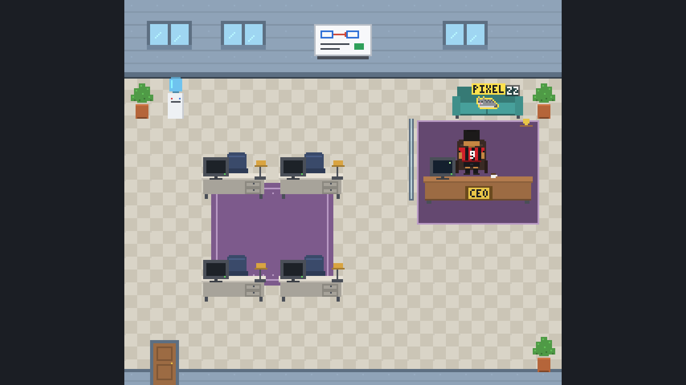

# agent-office

A pixel-art office in your terminal for your AI coding agents. Every Claude Code session gets a
desk pod. Its subagents and its agy calls (Antigravity CLI through `~/.claude/bin/agy-route`) sit
at the extra desks as interns. You can see who is typing, reading, running, thinking or waiting
on you, what each agent costs, and how much RAM the router has left. The office raises alerts and
lets you act on them: approve or deny a permission, cancel an agy call, or resume a session. A CEO
(you) sits in the corner office, and an office cat wanders the aisles.


| cyberpunk | an idle office (the CEO looks out of the window) |
|---|---|
|  |  |

The screenshots come from `cargo run -p office --example preview`, which writes every theme to
`target/preview/`.

Everything stays on your machine: there is no network access and no telemetry. The design
contract is in [docs/DESIGN.md](docs/DESIGN.md).

## Install

```sh
export PATH=/opt/homebrew/opt/rustup/bin:$HOME/.cargo/bin:$PATH   # Homebrew rustup
cargo install --path crates/office-hook     # the tiny hook shim agents call
cargo install --path crates/office          # the TUI
office install-hooks                        # Claude Code + Antigravity hooks
office install-hooks --permission           # also approve/deny from the office (needs permission_timeout_s > 0)
office doctor                               # check hooks, socket, router and config
office demo                                 # synthetic agents, no hooks needed
office                                      # the real thing
```

`office install-hooks` takes `--claude` or `--antigravity` to install only one side. Running it
again is safe, because it replaces its own entries and leaves your other hooks alone.

## Terminal support

The office is drawn as an image:

- **Kitty graphics** in Ghostty, kitty and WezTerm (sharpest, recommended).
- Sixel or iTerm2 inline images where the terminal supports them.
- **Half-blocks** (`▀` with 24-bit colour) everywhere else, including Terminal.app, tmux and SSH.

The mouse works too. Click an agent or a sidebar row to select it. Hover over the cat to see its
name.

## Keys

| key | action |
|---|---|
| `q` / `ctrl-c` | quit |
| `↑` `↓` / `j` `k`, `g` `G` | select an agent (or click it) |
| `enter` | agent details (tokens: in / cache-read / cache-write / out, cost, context, RSS, tools) |
| `a` / `d` | approve / deny the selected agent's pending permission |
| `x` | cancel the selected agy call (asks y/n, then SIGTERMs its router) |
| `o` | resume the selected Claude session (copies `cd … && claude --resume …`, opens Ghostty) |
| `t` | cycle theme presets |
| `T` | theme mixer: choose a theme for each layer |
| `s` | toggle the sidebar |
| `n` | toggle desktop notifications |
| `c` | clear alerts |
| `?` | help |

The sidebar and header count tokens **without cache reads**: fresh input, cache writes and output.
Long sessions re-read their whole context from the prompt cache on every turn, so including cache
reads would swamp the totals. The detail popup (`enter`) still lists all four token counts, and
cost always includes cache reads, which are billed at 10% of the input price.

## Configuration

`~/.config/agent-office/config.toml`. Every key is optional, and anything missing uses the default.

```toml
fps = 12                      # redraw rate
notifications = true          # macOS notifications for critical alerts and NeedsYou (toggle: n)
sidebar = true
cost_alert_usd = 50.0         # alert each time a session passes $50, $100, $150, … (0 = off)
stuck_after_s = 120           # "stuck" alert after this long without events
permission_timeout_s = 0      # > 0 enables approve/deny from the office (the hook waits this long)
agy_route = "~/.claude/bin/agy-route"   # path to the router (written out in full)

# Each layer can come from a different theme: procedural (drawn in code), modern, cozy, retro,
# cyberpunk, or your own pack in ~/.config/agent-office/themes/<name>/.
theme = { floor = "cozy", walls = "modern", furniture = "modern", decor = "cozy", characters = "procedural" }

# Presets that `t` cycles through.
[presets.night]
floor = "cyberpunk"
walls = "cyberpunk"
furniture = "cyberpunk"
decor = "cyberpunk"
characters = "cyberpunk"

[cat]
enabled = true
name = "Pixel"
color = "grey"                # grey | orange | black | white | calico

[ceo]
enabled = true
name = "CEO"                  # nameplate on the corner desk
number = 9                    # on the back of the jersey (0 = none)
skin = "#c68642"
hair = "black"                # black | brown | blonde | red | grey | white | "#rrggbb"
hair_style = "short"          # short | curly | long | bald

# $ per 1M tokens (input, output). The longest key found in the model id wins. Cache writes are
# priced at 125% of input and cache reads at 10%.
[prices]
opus = [15.0, 75.0]
sonnet = [3.0, 15.0]
haiku = [0.8, 4.0]

# agy role -> model, used until the router's audit log names the model.
[agy_models]
architect = "gemini-4-neon-high"
worker = "gemini-4-hydrogen-low"
supervisor = "gemini-4-neon-medium"
tester = "gemini-4-hydrogen-high"
```

## agy-route integration

The office watches `~/.claude/bin/agy-route` without changing it:

- Every second it scans `ps` for running routers (`agy-route --role <r> … --cwd <c>`, skipping
  `--dry-run`). Each router becomes an intern at the desk of the Claude session with the same
  cwd, labelled `<role>·<model>` and showing the router's summed RSS. It also reads the
  `~/.claude/run/agy-route.slot*.lock` and `agy-route.worker-*.lock` files for slots.
- Every 5 seconds it runs `agy-route --role fallback --prompt x --dry-run` and shows capacity,
  free RAM, per-process MB and memory pressure in the router gauge.
- It tails `~/.claude/run/agy-route.log.jsonl`. Failed calls (`TOOL_DENIED`, `TIMEOUT`,
  `EMPTY_RESPONSE`, `BUSY`) become alerts, and queued calls wait by the door.
- `x` cancels the selected agy call by sending SIGTERM to its router after you confirm.

## Premium themes

The bundled art is CC0. Paid packs can be used locally, for example LimeZu *Modern Interiors* /
*Modern Office* or Shubibubi *Cozy Interior*. **Never commit them**: their licences forbid
redistribution, and `themes/premium/` is in `.gitignore`.

```text
~/.config/agent-office/themes/premium/
├── theme.toml      # start from assets/themes/premium.example/theme.toml
├── tiles/          # Room_Builder_16x16.png, Interiors_16x16.png, Modern_Office_16x16.png, …
├── characters/     # Adam_idle_anim_16x16.png, … (16x32 cells)
├── animated/       # animated object strips (monitors, …)
├── pets/           # cat sheets
└── LICENSES/       # the licence files that came with the packs
```

```sh
mkdir -p ~/.config/agent-office/themes/premium
cp assets/themes/premium.example/theme.toml ~/.config/agent-office/themes/premium/
```

Then change the `file` names and tile coordinates in that `theme.toml` to match your pack version.
Any sprite you leave out is drawn procedurally. Select the theme with `t`, `T`, or
`theme = { furniture = "premium", … }`. If a sheet fails to load, the whole theme falls back to
procedural. `cargo run -p office --example preview` prints any theme errors. Agents, the CEO and the cat are still drawn in code (tinted by
the theme). The template already maps the character and cat sheets so they are ready for sprite
characters later.

## Uninstall

```sh
office install-hooks --uninstall            # removes only office-hook entries (Claude + Antigravity)
cargo uninstall office office-hook
rm -rf ~/.config/agent-office               # config and your own themes (optional)
```

## Credits

- Bundled sprite sheets: **Kenney** (kenney.nl), CC0 1.0: Roguelike Indoors, Roguelike Modern
  City and 1-Bit Pack. See [assets/CREDITS.md](assets/CREDITS.md).
- The procedural theme, the characters, the CEO, the cat and the 3×5 font are original and drawn
  in code.
- No assets from LimeZu, Shubibubi, Pixel Agents, Pixtuoid or LPC are bundled.
