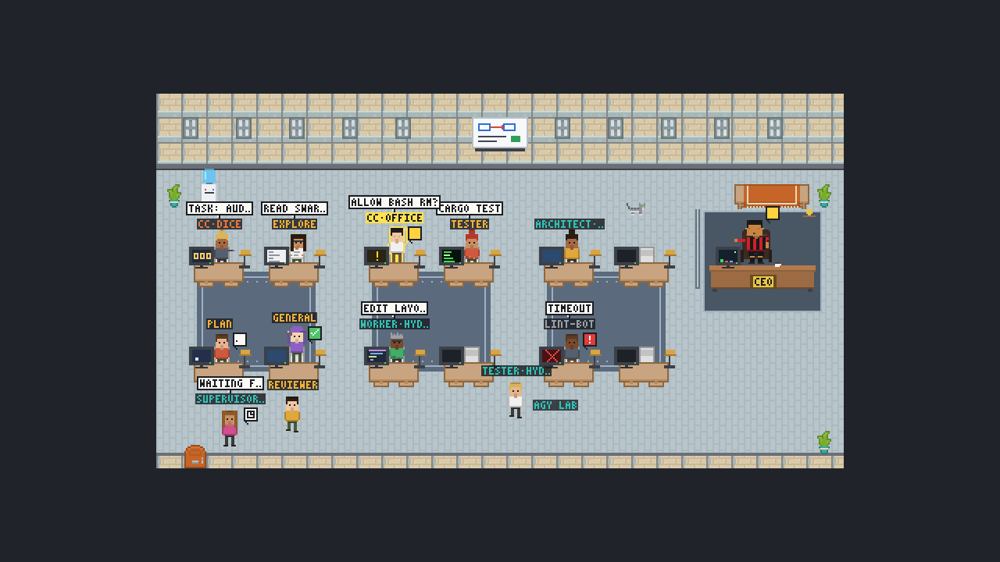

# office_mode

A pixel-art office in your terminal for your AI coding agents (**Claude Code** and **Antigravity**).

Every Claude Code session gets a desk pod; its subagents and `agy` / `agy-route` calls sit at intern desks. Watch who is typing, reading, running, thinking, or waiting on you, inspect tokens and cost, monitor router RAM, dispatch tasks or read agent reports from the Boss Inbox, approve/deny permissions live, reap idle/orphan processes, and wander with the office cat.

Both `office` and `office_mode` launch the app (`office_mode` is installed as an alias alongside `office` and `office-hook`).



| cyberpunk | an idle office (the CEO looks out of the window) |
|---|---|
|  |  |

The screenshots come from `cargo run -p office --example preview`, which writes every theme to `target/preview/`. Everything stays on your machine with zero telemetry. See [docs/DESIGN.md](docs/DESIGN.md) and the [user guide](docs/GUIDE.md).

---

## Install

### Homebrew (macOS & Linux)

```sh
brew install Rossonerian/tap/office_mode
```

*(Or `brew tap Rossonerian/tap && brew install office_mode`.)*

### `sudo` System-Wide Install (macOS & Linux)

```sh
curl -fsSL https://raw.githubusercontent.com/Rossonerian/office_mode/main/scripts/install.sh | sudo sh
```

Installs `office`, `office_mode`, `office-hook` into `/usr/local/bin` and bundled themes into `/usr/local/share/office_mode/assets` (verifies SHA-256 against `SHA256SUMS.txt`).
To install for your user only (`~/.local/bin`), omit `sudo`:

```sh
curl -fsSL https://raw.githubusercontent.com/Rossonerian/office_mode/main/scripts/install.sh | sh
```

### Windows (PowerShell)

```powershell
irm https://raw.githubusercontent.com/Rossonerian/office_mode/main/scripts/install.ps1 | iex
```

Installs `office.exe`, `office_mode.cmd`, `office-hook.exe`, and bundled `assets\` into `%LOCALAPPDATA%\office_mode`, verifies SHA-256, and adds it to your User `PATH`.

### Windows (Scoop)

```powershell
scoop install https://raw.githubusercontent.com/Rossonerian/office_mode/main/packaging/scoop/office_mode.json
```

### Build from Source (Cargo)

```sh
cargo install --path crates/office-hook
cargo install --path crates/office
```

---

## Quickstart

```sh
office install-hooks                        # wire Claude Code + Antigravity hooks
office install-hooks --permission           # also approve/deny from the office (needs permission_timeout_s > 0)
office doctor                               # verify hooks, IPC socket/port, themes, router and config
office demo                                 # preview with synthetic agents (no hooks needed)
office                                      # launch live office (or 'office_mode')
```

`office install-hooks` takes `--claude` or `--antigravity` to install only one side. Re-running is idempotent and leaves other hooks untouched.

---

## Terminal Support

- **Kitty graphics** in Ghostty, kitty, and WezTerm (sharpest, recommended).
- **Sixel / iTerm2** inline images where supported.
- **Half-blocks** (`▀` with 24-bit colour) everywhere else, including Terminal.app, Windows Terminal, tmux, and SSH.

Mouse click selects agents or sidebar rows; hovering over the cat reveals its name.

---

## Keys

| key | action |
|---|---|
| `q` / `ctrl-c` | quit |
| `↑` `↓` / `j` `k`, `g` `G` | select an agent (or click it) |
| `enter` | agent details (tokens: in / cache-read / cache-write / out, cost, context, RSS, tools) |
| `a` / `d` | approve / deny pending permission (`PermissionRequest`) |
| `p` | dispatch / assign a new task or follow-up (`agy`, `rosso-auto`, `claude`) |
| `x` | cancel selected agent/router call (asks y/n) |
| `K` | kill idle agents to free RAM (asks y/n) |
| `X` | reap orphan `agy` processes |
| `o` | resume selected session (copies resume command to clipboard; opens Ghostty on macOS) |
| `r` / `i` | reports / Boss Inbox reader (with Markdown export & clipboard copy) |
| `t` | cycle theme presets (`procedural`, `modern`, `cozy`, `retro`, `midnight`, `cyberpunk`, `nord`, `tokyo-night`, `retro-1bit`, `retro-amber`, `retro-gameboy`) |
| `T` | theme mixer: mix any theme per layer (`floor`, `walls`, `furniture`, `decor`, `characters`) |
| `v` | View menu (labels, bubbles, desk lighting, scanlines, fill viewport, strips) |
| `s` | toggle sidebar |
| `n` | toggle desktop notifications |
| `m` | toggle sound chimes (macOS) |
| `L` | toggle name tags & speech bubbles |
| `c` | clear alerts |
| `?` | scrollable help |

---

## Configuration

`~/.config/agent-office/config.toml` (every key is optional):

```toml
fps = 12
notifications = true
sound = false
sidebar = true
cost_alert_usd = 50.0
stuck_after_s = 120
permission_timeout_s = 0
agy_route = "~/.claude/bin/agy-route"

theme = { floor = "cozy", walls = "modern", furniture = "modern", decor = "cozy", characters = "procedural" }

[presets.night]
floor = "tokyo-night"
walls = "tokyo-night"
furniture = "tokyo-night"
decor = "tokyo-night"
characters = "tokyo-night"

[cat]
enabled = true
name = "Pixel"
color = "grey"                # grey | orange | black | white | calico

[ceo]
enabled = true
name = "CEO"
number = 9
skin = "#c68642"
hair = "black"                # black | brown | blonde | red | grey | white | "#rrggbb"
hair_style = "short"          # short | curly | long | bald

[prices]
opus = [15.0, 75.0]
sonnet = [3.0, 15.0]
haiku = [0.8, 4.0]

[agy_models]
architect = "gemini-4-neon-high"
worker = "gemini-4-hydrogen-low"
supervisor = "gemini-4-neon-medium"
tester = "gemini-4-hydrogen-high"
```

---

## Uninstall

- **Homebrew:** `office install-hooks --uninstall && brew uninstall office_mode`
- **sudo / script (macOS/Linux):** `office install-hooks --uninstall && curl -fsSL https://raw.githubusercontent.com/Rossonerian/office_mode/main/scripts/install.sh | sudo sh -s -- --uninstall`
- **Windows PowerShell:** `office install-hooks --uninstall; irm https://raw.githubusercontent.com/Rossonerian/office_mode/main/scripts/install.ps1 | iex` *(or run `install.ps1 -Uninstall`)*
- **Cargo:** `office install-hooks --uninstall && cargo uninstall office office-hook`

---

## Credits

- Bundled sprite sheets: **Kenney** (kenney.nl), CC0 1.0: Roguelike Indoors, Roguelike Modern City, 1-Bit Pack, and Tiny Town. See [assets/CREDITS.md](assets/CREDITS.md).
- The `procedural` theme, characters, CEO, cat, and 3×5 font are original and drawn in code.
- License: [MIT](LICENSE).
