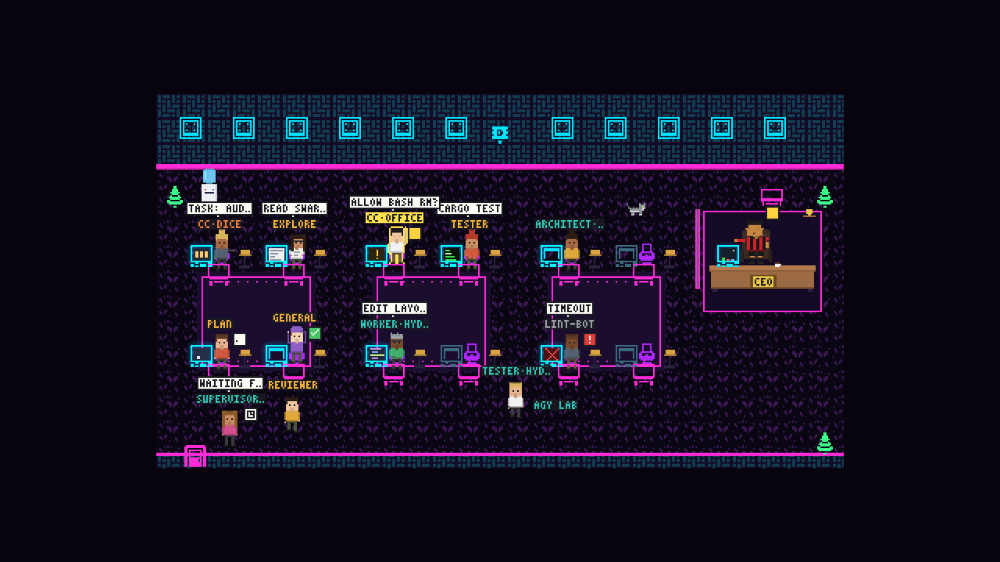

# office_mode

A pixel-art **native desktop app** (`office-desktop`) and **terminal office** (`office` / `office_mode`) for your AI coding agents (**Claude Code** and **Antigravity**).

[](https://github.com/Rossonerian/office_mode/releases/latest)
[](LICENSE)


[Features](#features) · [How It Works](#how-it-works) · [Install](#install) · [Quickstart](#quickstart) · [Terminal Support](#terminal-support) · [Controls](#controls) · [Configuration](#configuration) · [Uninstall](#uninstall)

Every Claude Code session gets a color-coded desk pod; its subagents and `agy` / `agy-route` calls sit at intern desks. Watch who is typing, reading, running, thinking, or waiting on you, inspect tokens and cost, monitor router RAM, dispatch tasks or read agent reports from the Boss Inbox, approve/deny permissions live, track progress on the office whiteboard, customize themes and your CEO outfit, reap idle/orphan processes, and wander with the office cat.


| cyberpunk | an idle office (the CEO looks out of the window) |
|---|---|
|  |  |

---

## Features

- **Live Agent Floorplan** — Each Claude Code session gets its own floor zone and desk pod, while subagents and `agy` / `agy-route` calls appear at intern desks. Poses and status icons show typing, reading, running, thinking, done, and waiting-on-you states in real time, complete with postmen delivering hand-offs, boss visits, a glass council cabin, and the wandering office cat.
- **Native Desktop App & Terminal TUI** — Launch the standalone native GUI window (`office desktop` / `office-desktop`, built with `eframe`/`egui`) on macOS, Linux, and Windows, or run directly inside your terminal (`office` / `office_mode`) with Kitty Graphics, Sixel/iTerm2, or 24-bit half-blocks.
- **Interactive Control** — Approve or deny live `PermissionRequest` prompts (`a` / `d` / `A`), dispatch new tasks or follow-up replies (`p` / `f` to `agy`, `claude`, or `rosso-auto`), resume sessions in a terminal (`o`), and read structured hand-off reports or Boss Inbox messages (`r` / `i`) with Summary/Full/Brief/Raw views, clipboard copy, and Markdown export.
- **Whiteboard Progress & Checklist** — Press `b` or click the wall whiteboard directly to manage manual checklist items alongside automatic ROSSO wave sync (`w`). Progress renders live on the pixel-art whiteboard and persists to `~/.config/agent-office/whiteboard.json`.
- **Cross-Platform Sound Feedback** — Toggle rate-limited chimes (`m`) across macOS (`afplay` with system `.aiff` or synth mode), Linux (`paplay`, `pw-play`, `aplay`, `canberra-gtk-play`), and Windows (Win32 `PlaySoundW`), backed by built-in pure-Rust WAV synthesis and optional custom WAV slots.
- **Custom Asset & CEO Outfit Import** — Import custom theme packs, individual sprite overrides, CEO outfits (`torso` or `full` mode), and WAV sound slots via `office import` or by dragging and dropping files onto the native desktop window; switch CEO outfits live from `Space` → `O`.
- **Observability & Resource Hygiene** — Four sidebar tabs (`1` Agents, `2` Jobs, `3` Activity, `4` Stats) track per-session cost, token usage, context, router slots/RAM pressure, and 30-minute cost/activity sparklines. Clean up memory with the Free RAM idle-agent killer (`K`), orphan `agy` reaper (`Space` → `R`), and brain directory pruner (`Space` → `B`).
- **Strictly Local** — Zero telemetry, no accounts, and no network calls. Events stay on your machine via a local IPC socket (`$TMPDIR/agent-office-<uid>/office.sock`) with atomic config writes and symlink-safe asset validation.

---

## How It Works

`office_mode` installs three small Rust binaries plus bundled sprite themes:

| Binary | Role |
|---|---|
| `office-hook` | Lightweight hook handler wired into Claude Code (`~/.claude/settings.json`) and Antigravity (`~/.gemini/config/plugins/agent-office/`). Streams session and tool events over the local IPC socket and optionally mediates `PermissionRequest` decisions. |
| `office` *(alias `office_mode`)* | Terminal TUI and CLI (`install-hooks`, `doctor`, `config`, `demo`, `import`, `desktop`). |
| `office-desktop` | Native desktop GUI application launched directly or via `office desktop [--demo]`. Shares the same live hook socket, config, themes, CEO outfits, and whiteboard state as the TUI. |

Run `office doctor` at any time to verify your config, IPC socket, bundled/custom themes, `office-hook`, `office-desktop`, audio backend & custom WAVs, CEO outfits, whiteboard file, Claude/Antigravity hooks, `agy-route` router capacity, and transcripts.

---

## Install

### Homebrew (macOS & Linux)

```sh
brew install Rossonerian/tap/office_mode
```

*(On Homebrew 5+, run `brew trust rossonerian/tap` first if prompted. You can also run `brew tap Rossonerian/tap && brew install office_mode`.)*

### Scoop (Windows)

```powershell
scoop install https://raw.githubusercontent.com/Rossonerian/office_mode/main/packaging/scoop/office_mode.json
```

### Install Script (macOS & Linux)

User-local install (`~/.local/bin` and `~/.local/share/office_mode/assets`):

```sh
curl -fsSL https://raw.githubusercontent.com/Rossonerian/office_mode/main/scripts/install.sh | sh
```

System-wide install (`/usr/local/bin` and `/usr/local/share/office_mode/assets`):

```sh
curl -fsSL https://raw.githubusercontent.com/Rossonerian/office_mode/main/scripts/install.sh | sudo sh
```

Both verify SHA-256 against `SHA256SUMS.txt` and install `office`, `office_mode`, `office-hook`, and `office-desktop`.

### Install Script (Windows PowerShell)

```powershell
irm https://raw.githubusercontent.com/Rossonerian/office_mode/main/scripts/install.ps1 | iex
```

Installs `office.exe`, `office_mode.cmd`, `office-hook.exe`, `office-desktop.exe`, and bundled `assets\` into `%LOCALAPPDATA%\office_mode`, verifies SHA-256, and adds the directory to your User `PATH`.

### Build from Source (Cargo)

```sh
cargo install --path crates/office-hook
cargo install --path crates/office
cargo install --path crates/office-desktop
```

---

## Quickstart

Wire hooks and verify your environment:

```sh
office install-hooks                # wire Claude Code + Antigravity hooks (--claude or --antigravity for one side)
office install-hooks --permission   # also approve/deny from the office (requires permission_timeout_s > 0)
office doctor                       # verify hooks, socket, themes, desktop, audio, outfits, whiteboard & router
```

Launch the native desktop app or terminal TUI (try `--demo` / `demo` first with synthetic agents):

```sh
office desktop --demo               # preview native desktop app with synthetic agents
office desktop                      # launch live native desktop app (or run `office-desktop` directly)
office demo                         # preview terminal TUI with synthetic agents
office                              # launch live terminal TUI (or `office_mode`)
```

Import custom themes, sprites, CEO outfits, or WAV chimes from the CLI:

```sh
office import theme ./my-theme neon-lab
office import sprite modern desk ./custom-desk.png
office import ceo-outfit ./tuxedo.png tuxedo --mode torso
office import sound inbox ./chime.wav
```

`office install-hooks` is idempotent and leaves all other hooks in `~/.claude/settings.json` untouched.

---

## Terminal Support

- **Native Desktop App (`office-desktop`)** — Built with `eframe`/`egui` for macOS, Linux, and Windows. Runs in its own window with crisp pixel-art scaling, mouse interaction, and drag-and-drop asset import without needing a graphics-capable terminal.

For the terminal TUI (`office` / `office_mode`), rendering adapts automatically to your terminal:

| Protocol | Supported Terminals | Notes |
|---|---|---|
| **Kitty Graphics** | Ghostty, kitty, WezTerm | Pixel-exact inline graphics (sharpest, recommended) |
| **Sixel / iTerm2** | iTerm2, foot, mlterm, Sixel terminals | Inline image protocol fallback where supported |
| **24-bit Half-Blocks** | Terminal.app, Windows Terminal, tmux, SSH | Universal `▀` true-color fallback everywhere else |

**Mouse interaction:** Click agents, sidebar rows/tabs, or alerts to select them; double-click an agent for details; click the wall whiteboard to open the checklist; click the Free RAM button in the sidebar to reclaim idle memory; hover over the office cat to reveal its name.

---

## Controls

### Navigation & Inspection

| Key | Action |
|---|---|
| `↑` `↓` / `j` `k` | Select previous / next agent (or click directly) |
| `g` / `G` (`Home` / `End`) | Jump to first / last agent (or row in Jobs / Activity) |
| `Tab` | Jump to the next agent that needs attention |
| `Enter` | Open selected agent details (`PgUp` / `PgDn` scrolls), or read highlighted inbox card / report |
| `1` `2` `3` `4` | Switch sidebar tabs (`Agents`, `Jobs`, `Activity`, `Stats`) and reveal sidebar |
| `r` / `i` | Open Reports (hand-offs) / Boss Inbox (`Tab` or `←` `→` switches Summary / Full / Brief / Raw; `y` copies; `w` saves Markdown; `g` jumps to sender) |
| `b` | Open the Whiteboard checklist (`a` add, `Space`/`Enter` toggle, `d` delete, `C` clear done, `w` toggle wave sync; or click the wall whiteboard) |

### Agent Control & Dispatch

| Key | Action |
|---|---|
| `Space` | Open the Command Center quick-actions palette (`p`, `f`, `K`, `R`, `A`, `i`, `o`, `B`, `b`, `O`) |
| `p` | Dispatch a new task (`agy` roles, `agy-cli`, `claude`, `claude-win`, `rosso-auto:council`, `rosso-auto:simple`) |
| `f` | Send a follow-up / reply to the selected agent (also works inside a report view) |
| `a` / `d` | Approve / deny pending `PermissionRequest` for the selected agent |
| `A` | Approve all pending permissions (asks `y`/`n`) |
| `o` | Resume selected session (copies command to clipboard; opens terminal on macOS) |
| `R` / `X` *(Jobs tab)* | Resume / abort the selected `rosso-auto` job (`X` asks `y`/`n`) |

### Process Management

| Key | Action |
|---|---|
| `x` | Stop / cancel the selected agent or router call (asks `y`/`n`) |
| `K` | Free RAM dialog: multi-select idle/done agents and orphan `agy` processes to terminate |
| `Space` → `R` | Reap orphan `agy` processes |
| `Space` → `B` | Prune old `agy` brain directories |

### Appearance, Audio & UI

| Key | Action |
|---|---|
| `t` | Open Theme Picker with swatches and live preview (`procedural`, `modern`, `cozy`, `midnight`, `tokyo-night`, `nord`, `retro`, `retro-1bit`, `retro-amber`, `retro-gameboy`, `cyberpunk`, plus custom themes & presets) |
| `[` / `]` | Cycle previous / next theme preset |
| `T` | Theme Mixer: mix any theme per layer (`floor`, `walls`, `furniture`, `decor`, `characters`) |
| `Space` → `O` | CEO Outfit picker (`(procedural)` or imported packs; `Tab`/`t` toggles `torso`/`full`, `r` reloads) |
| `v` | View menu (toggle overlays, lighting, scanlines, fill viewport, theme chrome; `c` clean, `a` all, `h` hide) |
| `z` | Toggle fill-viewport vs pixel-exact scaling |
| `L` | Toggle name tags & speech bubbles |
| `s` | Toggle sidebar visibility (persisted) |
| `n` | Toggle desktop notifications |
| `m` | Toggle cross-platform sound chimes (plays a test chime when turned on) |
| `c` / `C` | Clear alerts / restore all alerts |
| `?` | Scrollable in-app help |
| `q` / `Ctrl-C` | Quit (running agents keep working) |

---

## Configuration

`~/.config/agent-office/config.toml` (every key is optional; inspect the effective config with `office config`):

```toml
fps = 12
notifications = true
sound = false
sidebar = true
cost_alert_usd = 50.0
stuck_after_s = 120
permission_timeout_s = 0
agy_route = "~/.claude/bin/agy-route"

theme = { floor = "cozy", walls = "modern", furniture = "modern", decor = "cozy", characters = "procedural" }

[sounds]
mode = "system"               # "system" (macOS .aiff + synth fallback) | "synth" (pure-Rust WAV everywhere)
# Custom WAV filenames inside ~/.config/agent-office/sounds/ (imported via `office import sound`):
# test = "test.wav"
# needs_you = "needs-you.wav"
# inbox = "inbox.wav"
# error = "error.wav"

[presets.night]
floor = "tokyo-night"
walls = "tokyo-night"
furniture = "tokyo-night"
decor = "tokyo-night"
characters = "tokyo-night"

[cat]
enabled = true
name = "Pixel"
color = "grey"                # grey | orange | black | white | calico

[ceo]
enabled = true
name = "CEO"
number = 9
skin = "#c68642"
hair = "black"                # black | brown | blonde | red | grey | white | "#rrggbb"
hair_style = "short"          # short | curly | long | bald
# outfit = "tuxedo"           # installed pack name under ~/.config/agent-office/outfits/
outfit_mode = "torso"         # torso | full
# primary_color = "#1f4e79"   # optional "#rrggbb" jersey/suit override
# secondary_color = "#f2c14e" # optional "#rrggbb" accent/collar override

[prices]
opus = [15.0, 75.0]
sonnet = [3.0, 15.0]
haiku = [0.8, 4.0]

[agy_models]
architect = "gemini-4-neon-high"
worker = "gemini-4-hydrogen-low"
supervisor = "gemini-4-neon-medium"
tester = "gemini-4-hydrogen-high"
```

---

## Uninstall

Remove agent hooks first, then uninstall the binaries via the method you used to install:

### Homebrew

```sh
office install-hooks --uninstall
brew uninstall office_mode
```

### Scoop (Windows)

```powershell
office install-hooks --uninstall
scoop uninstall office_mode
```

### Install Script (macOS & Linux)

```sh
office install-hooks --uninstall
curl -fsSL https://raw.githubusercontent.com/Rossonerian/office_mode/main/scripts/install.sh | sh -s -- --uninstall
```

*(Add `sudo` before `sh` if installed system-wide.)*

### Install Script (Windows PowerShell)

```powershell
office install-hooks --uninstall
& ([scriptblock]::Create((irm https://raw.githubusercontent.com/Rossonerian/office_mode/main/scripts/install.ps1))) -Uninstall
```

### Cargo

```sh
office install-hooks --uninstall
cargo uninstall office office-hook office-desktop
```

---

## Documentation & Development

- **User Guide:** [docs/GUIDE.md](docs/GUIDE.md) — walkthrough of ROSSO titles, report reader, sidebar tabs, native desktop app, whiteboard checklist, custom assets/outfits, sound chimes, and troubleshooting.
- **Architecture & Design:** [docs/DESIGN.md](docs/DESIGN.md) — crate boundaries, scene model, IPC protocol, rendering pipeline, and security invariants.
- **Theme Previews:** Run `cargo run -p office --example preview` to render every theme to `target/preview/` (used to generate the screenshots above).
- **Test Suite:** Run `cargo test --workspace` to execute the full test suite.

---

## Credits & License

- **Bundled Sprite Sheets:** **Kenney** ([kenney.nl](https://kenney.nl)), CC0 1.0 — *Roguelike Indoors*, *Roguelike Modern City*, *1-Bit Pack*, and *Tiny Town*. See [assets/CREDITS.md](assets/CREDITS.md).
- **Procedural Assets:** The `procedural` theme, characters, CEO, office cat, 3×5 bitmap font, and synthesized chime waveforms are original and generated in code.
- **License:** [MIT](LICENSE).
